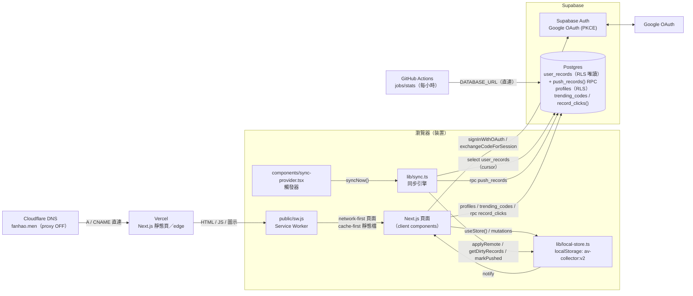
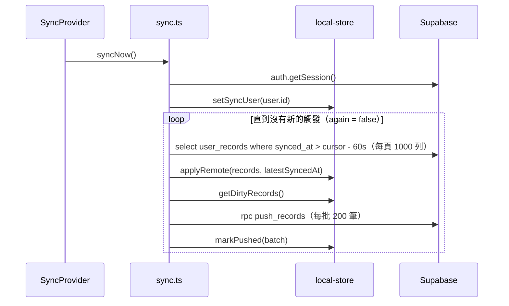

# 系統架構

> 相關文件：[README](./README.md) · [資料庫](./database.md) · [部署](./deployment.md) · [開發指南](./development.md) · [使用者旅程](./user-journey.md)

## 總覽



重點：

- **沒有自己的後端 API。** 瀏覽器直接用 `@supabase/supabase-js` 跟 Supabase 溝通，權限完全靠 RLS 與 `security definer` 函式把關。
- Vercel 只負責送出 Next.js 的頁面與靜態檔；伺服器端不碰使用者資料。
- 分享連結把清單放在 URL hash，hash 不會送到伺服器。

## 設計原則

| 原則 | 實作方式 |
| --- | --- |
| Local-first | `localStorage` 是唯一真實資料來源（single source of truth）。雲端只是鏡像，離線或未登入時一切照常 |
| 無 server actions、無 ORM | 沒有 `"use server"`、沒有 Prisma。雲端存取只有 `supabase.from("user_records").select(...)` 與 `supabase.rpc("push_records")` |
| 讀資料的頁面一律是 client component | 頁面加 `"use client"`，用 `useStore()`；SSR／hydration 前它回傳 `null`，此時顯示 `<PageLoading />` |
| Server component 只做 metadata | 例如各路由的 `layout.tsx` 只輸出 `metadata`（標題、`robots`），首頁與 `/about` 是純靜態內容 |
| 登入是選配 | 沒有 Supabase 環境變數時 `authEnabled === false`，整個帳號 UI 隱藏 |
| UI 語言 | 繁體中文，`<html lang="zh-Hant">` |

## 目錄結構

```
app/
├── layout.tsx                # 根 layout：metadata、Toaster、ServiceWorkerRegister、SyncProvider、GA
├── page.tsx                  # 著陸頁（含 JSON-LD），CTA → /dashboard
├── (main)/                   # 共用 Navbar + container 的 route group，沒有任何頁面需要登入
│   ├── layout.tsx
│   ├── dashboard/            # 清單列表、示範資料按鈕；new/ 建立清單
│   ├── playlist/[id]/        # 清單詳細頁（client，依 id 讀 store）
│   ├── share/                # 解析 URL hash 的分享清單
│   ├── explore/              # 熱門番號排行（讀 trending_codes，開發中）
│   ├── settings/             # 帳號與同步、個人資料、自訂來源、JSON 備份／匯入、清除資料
│   └── about/                # 唯一會被索引的內頁
│   （layout.tsx 也掛載 OnboardingDialog）
├── auth/callback/page.tsx    # OAuth 回呼：用 ?code= 換 session，再導回登入前的頁面
├── manifest.ts / icon.tsx / apple-icon.tsx / pwa-icon/[size]/route.ts
├── robots.ts / sitemap.ts / opengraph-image.tsx
└── not-found.tsx / loading.tsx
lib/
├── local-store.ts            # 資料層（store、mutations、同步輔助函式）
├── sync.ts                   # 同步引擎（pull / push / syncNow / useSyncStatus）
├── supabase.ts               # Supabase client、authEnabled、signInWithGoogle、useSession
├── profile.ts                # profiles 讀寫、useProfile、validateDisplayName
├── trending.ts               # fetchTrending、recordClicks、stats opt-out
├── recent-opens.ts           # 最近開啟紀錄（只存本機，不同步）
├── share-codec.ts            # 分享連結 encode / decode
├── code-normalizer.ts        # 番號正規化與驗證
├── url-parser.ts             # 從網址或文字取出番號
├── default-templates.ts      # 內建來源範本、mergeTemplates()
├── analytics.ts              # GA4 事件包裝
├── site.ts                   # 網站名稱、網址、標題、描述
└── app-icon.tsx              # 所有圖示共用的繪製函式
components/                   # 頁面元件；ui/ 是 shadcn/ui
public/sw.js                  # Service worker
supabase/migrations/          # 依檔名順序套用的 SQL
jobs/stats/                   # 熱門排行統計腳本（npm run stats）
.github/workflows/            # 定時執行 jobs/stats
```

## 資料層（`lib/local-store.ts`）

### Store 結構（v2）

`localStorage` key：`av-collector:v2`

```ts
interface StoreData {
  version: 2
  playlists: Playlist[]          // 新的在前
  templates: SourceTemplate[]    // 使用者自訂來源（內建的不存）
  deleted: Record<string, { kind: "playlist" | "template"; at: string }> // tombstone
  sync: { userId: string | null; cursor: string | null; dirty: string[] } // 不會匯出到備份
}
interface Playlist { id; name; description: string | null; items: PlaylistItem[]; createdAt; updatedAt }
interface PlaylistItem { id; videoCode; normalizedCode; note: string | null; createdAt }
interface SourceTemplate { id; name; baseTemplate; isDefault; isBuiltIn?; updatedAt? }
```

- id 由 `nanoid(10)` 產生；時間都是 ISO 字串。
- 清單項目的順序就是陣列順序。

### 讀取

- `useStore()` 以 `useSyncExternalStore` 實作，SSR 時的 snapshot 是 `null`。
- 記憶體內有 `cache`；同一台裝置的其他分頁透過 `storage` 事件得知變更（清掉 cache 後重新讀取）。

### 寫入：一律透過 exported mutation

| 函式 | 作用 | 標記為 dirty 的 id |
| --- | --- | --- |
| `createPlaylist` | 建立清單（可帶初始項目） | 新清單 id |
| `updatePlaylist` | 改名稱、描述 | 清單 id |
| `deletePlaylist` | 刪除並寫入 tombstone | 清單 id |
| `restorePlaylist` | 復原（移除 tombstone，`updatedAt` 設為現在） | 清單 id |
| `addItems` | 依 `normalizedCode` 去重後加入，回傳實際加入數 | 清單 id |
| `deleteItems` / `restoreItems` / `updateItemNote` | 項目操作；復原是整份 snapshot 覆蓋 | 清單 id |
| `createTemplate` / `deleteTemplate` | 自訂來源（`baseTemplate` 必須含 `{code}` 且能組成合法 URL） | 範本 id |
| `importData(json, "merge" \| "replace")` | 匯入備份；匯入的紀錄 `updatedAt` 設為現在，以便蓋過舊的雲端版本 | 所有新增／移除的 id |
| `clearAllData` | 刪除全部並寫 tombstone（登入時會同步刪雲端） | 全部 id |
| `resetLocalData` | 只清這台裝置，不同步 | 無 |
| `loadDemoData` | 建立示範清單 | 新清單 id |

規則：

1. **每個 mutation 都要呼叫 `save(next, touched)`**，`touched` 是這次動到的 id。`save()` 會把它們併入 `sync.dirty`，同步引擎只會推送 dirty 的紀錄。漏了 `touched` 就不會上雲。
2. **刪除必須寫 tombstone**（`deleted[id] = { kind, at }`），否則其他裝置不會知道它被刪了。
3. 修改清單內容一律經過 `updatePlaylistIn()`，它會自動更新 `updatedAt`。同步的衝突解決依賴這個時間戳。
4. `save()` 寫入失敗（儲存空間滿、被停用）會丟出中文錯誤訊息，呼叫端用 toast 顯示。

### 從 v1 遷移

`load()` 先讀 `av-collector:v2`，沒有就讀 `av-collector:v1`，一律經過 `normalize()`：補上 `deleted`、`sync`，並把沒有 `updatedAt` 的範本設為 epoch（`1970-01-01T00:00:00.000Z`）。第一次 `save()` 後資料就以 v2 key 寫回；v1 key 不會被刪除。日後若再改變結構，請換 key／version 並在 `normalize()` 裡遷移。

## 同步引擎（`lib/sync.ts`）

同步以「紀錄」為單位：一份清單或一個自訂來源 = `user_records` 的一列（tombstone 也是一列，`deleted = true`、`data = null`）。

### 流程：`syncNow()`



| 步驟 | 細節 |
| --- | --- |
| Pull | 依 `synced_at`、`id` 排序分頁讀取。cursor 是已讀到的最大 `synced_at`（伺服器時間）；查詢時往前多讀 60 秒（`CURSOR_OVERLAP_MS`），涵蓋較晚 commit、但 `synced_at` 較早的交易 |
| Merge | `applyRemote()` 逐筆比較：遠端 `updatedAt` **嚴格較新**才覆蓋本機（整份清單取代）。遠端是 tombstone 就刪本機並寫 tombstone。被覆蓋的 id 會從 `dirty` 移除。格式不對的資料（非刪除卻沒有 `data`、清單沒有 `items` 陣列）直接略過 |
| Push | 把 dirty 紀錄送到 `push_records()`。伺服器只在 `excluded.updated_at > 既有 updated_at` 時才更新，所以舊裝置無法蓋掉新資料 |
| 清除 dirty | `markPushed()` 只清掉「推送時的 `updatedAt` 跟現在本機一樣」的紀錄；推送途中又被改過的會留到下一輪 |
| 併發 | 同一時間只跑一個 sync；期間再被呼叫會設 `again = true`，跑完再補一輪 |
| 狀態 | `useSyncStatus()` 提供 `idle / syncing / error`、`lastSyncedAt`、`error`，navbar 與設定頁顯示 |

### 觸發時機（`components/sync-provider.tsx`）

| 事件 | 延遲 |
| --- | --- |
| `onAuthStateChange` 的 `INITIAL_SESSION`、`SIGNED_IN`（有 session 時） | 0 |
| `visibilitychange` 回到 `visible` | 0 |
| `online` | 0 |
| store 有變更且 `dirty` 非空 | 2 秒 debounce（`EDIT_DEBOUNCE_MS`） |
| 設定頁「立即同步」按鈕 | 立即 |

觸發一律透過 `setTimeout` 排程，因為 Supabase 不建議在 `onAuthStateChange` callback 內 await 自己的 API。

### 切換帳號

`setSyncUser(userId)`：如果和 store 記錄的 `sync.userId` 不同，就把 cursor 歸零，並把本機所有清單、範本、tombstone 都標成 dirty。效果：

- 第一次登入：本機資料全部上傳，並從頭拉下雲端資料合併。
- 換成另一個帳號：本機資料會**併入新帳號**（重新上傳全部）。
- 登出（`AccountSection`）：先嘗試把 pending 變更推完，再 `signOut()`、`setSyncUser(null)`；使用者可選擇同時 `resetLocalData()`。選擇移除資料時若仍有未上傳變更，會中止登出並提示。

### 已知限制

- **整份清單 LWW（last-write-wins）**：衝突以整份清單為單位。兩台裝置離線時各自加了不同項目，同步後只會保留 `updatedAt` 較新的那份，另一邊的變更會遺失。
- **時鐘偏差**：`updatedAt` 是客戶端時間。某台裝置時鐘快很多時，它的編輯會一直「贏」；時鐘慢的裝置的新編輯可能被伺服器的 `push_records` 忽略。
- 刪除後再復原能成功，是因為 `restorePlaylist()` 把 `updatedAt` 設為現在，比 tombstone 新。
- Tombstone 永遠不會清除（本機 `deleted` 與雲端列都會一直存在）。
- 同步只在前景執行，沒有 Background Sync。
- 每筆 `data` 大小受 DB check 限制（< 1,000,000 bytes，見 [database.md](./database.md)）。

## 認證（`lib/supabase.ts`、`app/auth/callback`）

- 只支援 **Google OAuth**，走 PKCE（`flowType: "pkce"`）。
- `getSupabase()` 在沒有環境變數或 SSR 時回傳 `null`；`authEnabled` 決定是否顯示帳號 UI。
- Client 設定 `detectSessionInUrl: false`：不讓 supabase-js 自動解析網址，而是由 `/auth/callback` 明確呼叫 `exchangeCodeForSession(code)`。
- 登入流程：

  1. `signInWithGoogle()`（`lib/supabase.ts`）先把目前路徑存進 `sessionStorage`（key `AUTH_RETURN_KEY`），再呼叫 `signInWithOAuth({ provider: "google", options: { redirectTo: "<origin>/auth/callback" } })`。`redirectTo` 不帶 query，才能和 Supabase Redirect URLs 完全比對。
  2. Google → Supabase（`https://<project-ref>.supabase.co/auth/v1/callback`）→ 回到 `/auth/callback?code=...`，讀取並清除 `sessionStorage` 裡的路徑後導回（舊連結的 `?next=` 仍相容）。
  3. Callback 頁換取 session 後 `router.replace(next)`。`next` 經過 `safeNext()` 過濾，只接受 `/` 開頭、非 `//` 開頭的站內路徑，防止 open redirect。
  4. 網址帶 `error` 時顯示 `error_description`；換 code 失敗顯示「登入連結已失效」。

- `useSession()` 回傳 `{ ready, session }`；`ready` 在 Supabase 從 storage 還原 session（第一次 `onAuthStateChange`）之前是 `false`，UI 應在此之前不顯示登入／登出按鈕，避免閃爍。
- Service worker 不快取 `/auth/` 路徑（網址裡有一次性 code），`robots.ts` 也 disallow `/auth/`。
- Session 存在 supabase-js 預設的 `localStorage`，所以 PWA 與瀏覽器各自需要登入一次。

### 首次登入（onboarding）與個人資料

- `lib/profile.ts` 的 `useProfile()` 在登入後讀取自己的 `profiles` 列，狀態為 `signed-out / loading / error / ready`；`ready` 且 `profile === null` 代表尚未完成 onboarding。
- `components/onboarding-dialog.tsx`（掛在 `app/(main)/layout.tsx`）在這種狀態下自動開啟，以 Google 的名字（`user_metadata.full_name`／`name`）預填暱稱；使用者可關閉，本次瀏覽不再出現。
- `saveProfile()` 以 `upsert` 寫入 `display_name`、`show_email`、`updated_at`；`validateDisplayName()` 與 DB 的 1–20 字檢查一致（以 code point 計算長度）。
- Profile 不屬於 local-first 資料：不存在 `localStorage`、不經同步引擎，直接讀寫 Supabase。

> 註：登入／onboarding 相關程式碼在撰寫本文時仍在修改中（email 驗證碼登入已移除，改為 Google-only），細節以程式碼為準。

## 分享連結（`lib/share-codec.ts`）

不經伺服器，整份清單放在 URL hash：

```
https://fanhao.men/share#z=<base64url(deflate-raw(JSON))>
https://fanhao.men/share#j=<base64url(JSON)>      # 瀏覽器沒有 CompressionStream 時
```

精簡的 payload：

```ts
type Payload = { n: string; d?: string; i: ([code] | [code, note])[] }
```

- 編碼：`encodeShareHash()`；解碼：`decodeShareHash()`，會檢查 `n` 是字串、`i` 是陣列，並過濾掉格式不對的項目。
- `/share` 頁面會監聽 `hashchange`，並對每個番號重新跑 `isValidVideoCode` + `normalizeVideoCode`，因為資料來自網址，不可信。
- 分享連結是**分享當下的快照**，原清單之後的修改不會反映。
- 接收者可把項目加入自己的清單（`add-items-to-playlist-dialog.tsx`）。

## 番號正規化與網址解析

### `lib/code-normalizer.ts`

| 輸入 | `normalizeVideoCode` 輸出 | 規則 |
| --- | --- | --- |
| `ssis123`、` SSIS-123 ` | `SSIS-123` | 去空白、轉大寫、去 `-`，「字母 + 數字」中間補 `-` |
| `fc2ppv1234567`、`FC2-PPV-1234567` | `FC2-PPV-1234567` | `FC2PPV` + 數字 |
| `1234567`（6–8 位純數字） | `FC2-PPV-1234567` | 視為 FC2 |
| 其他（如 `T28-123`、`ABC.123`） | 只轉大寫、去空白 | 不符合以上規則就原樣保留 |

`isValidVideoCode`：FC2 兩種格式直接通過；其他需要長度 ≥ 3 且至少含一個英文字母與一個數字。資料同時存原始輸入 `videoCode` 與 `normalizedCode`，去重以 `normalizedCode` 為準。

### `lib/url-parser.ts`

`parseVideoInput(input)` / `parseMultipleInputs(text)`（一行一筆）：

- 只有 `http(s)://` 開頭，或形如 `domain.tld/path` 才當成網址；所以 `ABC.123` 仍會被當作番號。
- 支援的網站：

| 網站 | 取番號的方式 |
| --- | --- |
| missav（任何網域） | 路徑最後一段 |
| javdb | `/v/<id>` |
| javlibrary | `?v=` |
| fc2 | 路徑中 6–8 位數字，或 `fc2-ppv-數字` |
| 其他 | 路徑最後一段，且需通過 `isValidVideoCode` |

### 來源範本

- 內建範本在 `lib/default-templates.ts`（MissAV、Jable、JAVDB、JavLibrary、Sukebei），id 以 `default-` 開頭，不存進 store。
- `mergeTemplates(store.templates)`：使用者範本在前、內建在後；若使用者有設預設，內建範本全部改為非預設。結果傳給 `LinkGeneratorPopover`。

## PWA 與 Service Worker

| 項目 | 檔案 |
| --- | --- |
| Manifest | `app/manifest.ts`（`start_url: /dashboard`、`display: standalone`、theme `#18181b`） |
| 圖示 | `app/icon.tsx`、`app/apple-icon.tsx`、`app/pwa-icon/[size]/route.ts`（192、512，`force-static`），都用 `lib/app-icon.tsx` 繪製；512 同時當 maskable |
| 註冊 | `components/service-worker-register.tsx`，**只在 production** 註冊（dev 下會快取到過期的 Turbopack chunk） |
| 標頭 | `next.config.ts` 讓 `/sw.js` 回傳 `Cache-Control: no-cache, no-store, must-revalidate` |

`public/sw.js` 快取策略（撰寫時 `CACHE_VERSION = "v3"`）：

| 請求 | 策略 |
| --- | --- |
| 安裝時 | 預先快取 `/dashboard`、`/dashboard/new`、`/explore`、`/settings`、`/about`、`/share`，接著 `skipWaiting()` |
| `/_next/static/*`、`/pwa-icon/*` | Cache-first（檔名有 hash，不會變），存到 `assets-<版本>` |
| 頁面導覽（`mode === "navigate"`，`/auth/*` 除外） | Network-first，成功就以 pathname 為 key 存到 `pages-<版本>`；離線時回傳快取，沒有快取就回傳內嵌的離線頁 |
| 其他（非 GET、跨網域、RSC fetch） | 不處理，直接走網路 |
| 啟用時 | 刪除名稱不是目前版本的 cache，`clients.claim()` |

修改 `sw.js` 時要調高 `CACHE_VERSION`。離線行為請用 `npm run build && npm run start` 測試，不要用 `dev`。安裝 PWA 需要 HTTPS（或 localhost）。

## SEO

| 項目 | 內容 |
| --- | --- |
| 全站 metadata | `app/layout.tsx`：`metadataBase`、title template `%s｜fanhao.men`、description、keywords、Open Graph（`zh_TW`）、Twitter `summary_large_image`、`appleWebApp` |
| 網站常數 | `lib/site.ts`：`SITE_NAME`、`SITE_URL`、`SITE_TITLE`、`SITE_DESCRIPTION`。`SITE_URL` 依序取 `NEXT_PUBLIC_SITE_URL` → `https://${NEXT_PUBLIC_VERCEL_PROJECT_PRODUCTION_URL}` → `http://localhost:3000`，並去掉結尾 `/` |
| OG 圖片 | `app/opengraph-image.tsx`，1200×630，只用英文（預設字型沒有 CJK 字形） |
| 首頁 | canonical `/`，附 `WebApplication` JSON-LD |
| `/about` | canonical `/about`，可被索引 |
| `noindex, nofollow` | `/dashboard`（含 `/dashboard/new`）、`/playlist/*`、`/explore`、`/settings`、`/share`，在各自的 `layout.tsx` 設定 |
| `robots.ts` | allow `/`、disallow `/auth/`，指向 sitemap |
| `sitemap.ts` | 只有 `/` 與 `/about` |

## Analytics（`lib/analytics.ts`）

`NEXT_PUBLIC_GA_MEASUREMENT_ID` 有值時，`app/layout.tsx` 載入 `@next/third-parties` 的 `GoogleAnalytics`；`trackEvent()` 在 `window.gtag` 不存在時什麼都不做。

| 事件 | 觸發位置 | 參數 |
| --- | --- | --- |
| `add_items_to_playlist` | `unified-add-videos-dialog.tsx` | `playlist_id`、`item_count`、`method`（`single`／`bulk`／`url_parse`） |
| `generate_links` | `link-generator-popover.tsx` | `source_name`、`item_count`、`is_single_item` |
| `copy_codes` | `smart-action-toolbar.tsx` | `item_count`、`has_selection` |
| `create_playlist` | `dashboard/new/page.tsx` | `playlist_id`、`has_description` |
| `delete_items` | `playlist-page-client.tsx` | `playlist_id`、`item_count` |
| `share_playlist` | `playlist-header.tsx` | `playlist_id`、`method` |
| `add_from_shared_playlist` | `add-items-to-playlist-dialog.tsx` | `source_playlist_id`（`share`／`explore`／`playlist`／`recent`）、`target_playlist_id`、`item_count` |
| `update_note` | `edit-note-dialog.tsx` | `playlist_id`、`has_note` |
| `create_template` | `settings/page.tsx` | `template_id`（實際傳的是範本名稱）、`is_default` |
| `copy_code_from_share` | `share-page-content.tsx` | `code` |
| `copy_url_from_share` | `share-page-content.tsx` | `source_name` |

## 最近開啟（`lib/recent-opens.ts`）

使用者從網站開啟來源連結後，可以事後勾選要把哪些番號加入清單。

- 獨立的 `localStorage` key `av-collector:recent-opens`：`{ entries: { code, openedAt }[], dismissedAt }`，新的在前，最多 100 筆，超過 7 天的在讀取時丟掉。**不屬於 store**：不經 `save()`、不同步、不進備份、不納入熱門統計。
- 寫入點：`LinkGeneratorPopover` 的「開啟」連結與單一番號的「複製連結」、分享頁的開啟／複製連結，都在 `recordClicks()` 旁呼叫 `rememberOpened(codes)`。批次複製多個番號的連結不記錄，避免把列表塞滿。同一番號再開會移回最上面。
- 讀取：`useRecentOpens()`（`useSyncExternalStore`，SSR 回傳 `null`，其他分頁透過 `storage` 事件更新）。
- UI（`components/recent-opens.tsx`）：
  - `RecentOpensPrompt` 掛在 `app/(main)/layout.tsx`，有「不在任何清單、且晚於 `dismissedAt`」的紀錄時浮出提示；按 ✕ 或關閉對話框會 `dismissRecentOpens()`。
  - `RecentOpensDialog` 列出全部紀錄，已在清單的標示且預設不勾，勾選的經 `AddItemsToPlaylistDialog`（`source="recent"`）加入後 `forgetOpened()`。我的清單頁也有入口按鈕。
- 限制：跨網域看不到使用者在對方網站內的瀏覽，也無法得知停留時間，所以只記錄從本站點出去的連結。

## 熱門排行（開發中）

- `/explore` 透過 `fetchTrending("7d" | "30d")` 讀 `trending_codes`（anon 也可讀）。
- 登入使用者在分享頁或連結產生器開啟／複製連結時，`recordClicks(codes)` 以 fire-and-forget 呼叫 `record_clicks()` RPC；同一天同一番號在前端只送一次，伺服器也會去重並限量。
- 設定頁可關閉「參與熱門統計」（寫入／刪除 `stats_opt_outs`）。
- 排名由 `jobs/stats/run.mjs` 計算，`.github/workflows` 每小時執行（需要 repository secret `DATABASE_URL`）。細節見 [database.md](./database.md#熱門統計0003_trending尚未-commit)。

## 安全性標頭

`next.config.ts` 對所有路徑加上 HSTS（`max-age=63072000; includeSubDomains; preload`）、`X-Frame-Options: DENY`、`X-Content-Type-Options: nosniff`、`Referrer-Policy: strict-origin-when-cross-origin`、`Permissions-Policy`（停用相機、麥克風、定位）等。
