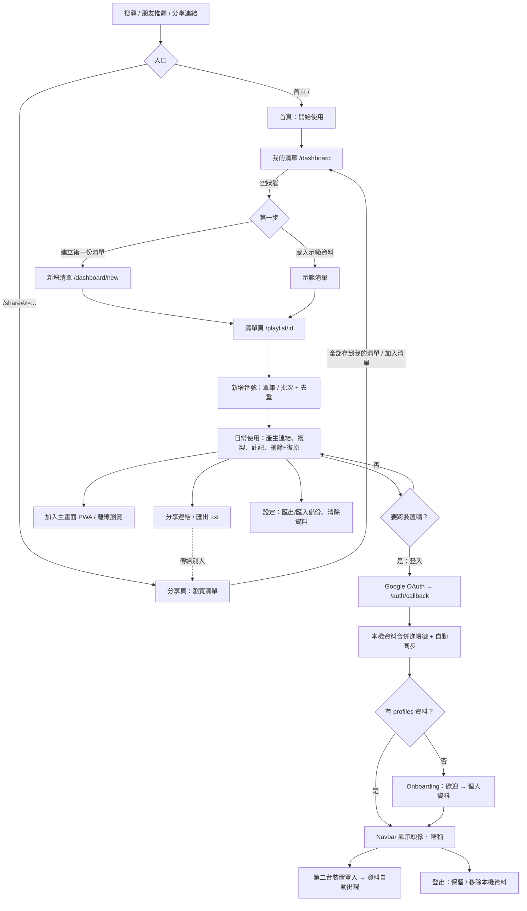
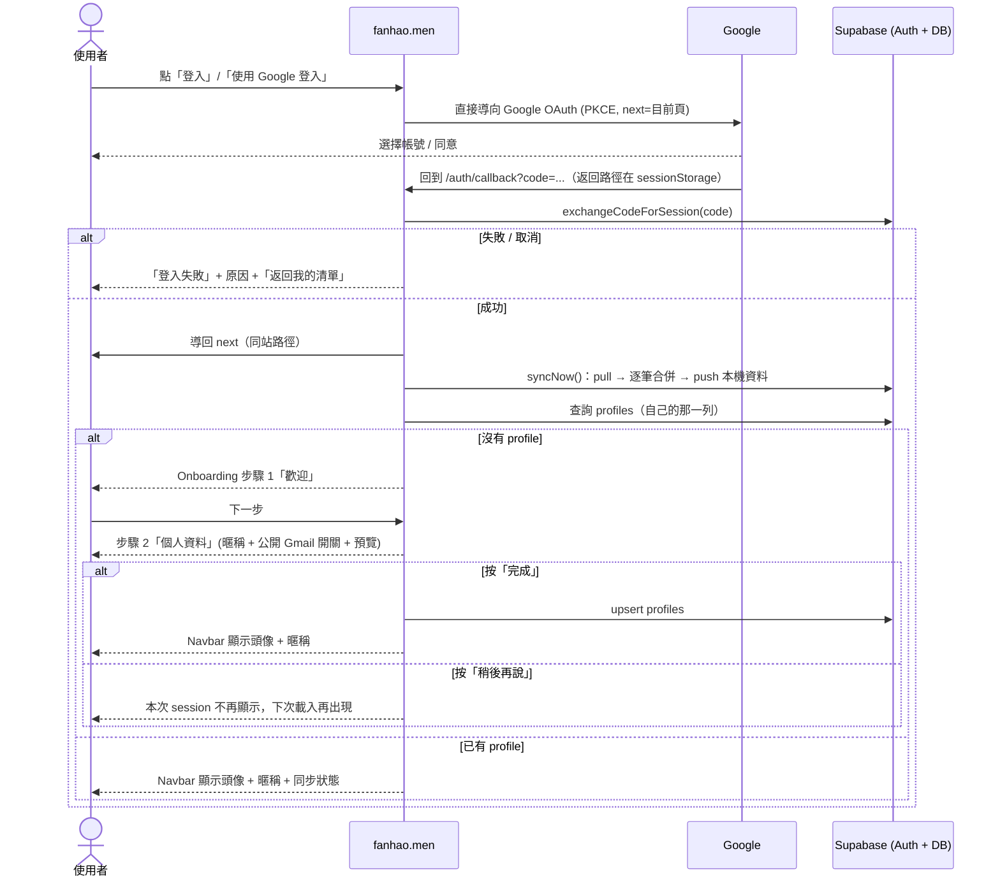

# fanhao.men 使用者旅程

> 適用版本：Google 登入 + 首次登入 onboarding 改版（實作中）。
> 本文描述**目前已存在**的功能；標示「未實作」的段落為規劃方向，不代表現況。

---

## 1. 產品定位與核心原則

fanhao.men 是一個管理「番號清單」的免費工具：建立清單、批次貼番號、一鍵產生影片網址、用連結分享。

| 原則 | 具體做法 | 為什麼 |
|---|---|---|
| **Local-first** | 所有資料存在瀏覽器 `localStorage`（`av-collector:v2`），不登入也能完整使用 | 降低門檻：第一次來的人不需要註冊就能立刻用；也沒有伺服器掛掉就不能用的問題 |
| **ID-first** | 存的是番號（`SSIS-123`、`FC2-PPV-1234567`），網址由「影片來源」範本 `{code}` 即時產生 | 影片網站常換網域或倒站，番號才是穩定的識別；使用者可自訂偏好網站 |
| **隱私優先** | 分享連結把清單放在 URL hash（`#z=...`），hash 不會送到伺服器；登入只用來同步，沒有任何公開頁面 | 這類收藏屬敏感內容，預設不留痕、不公開 |
| **登入是加值，不是門票** | 登入（Google）只多了「跨裝置同步」；沒登入的功能一樣都不少 | 避免用「強迫註冊」換使用者；同時保留未來社群功能的身分基礎 |

---

## 2. 使用者類型

| Persona | 情境 | 主要需求 | 最在意 | 主要觸點 |
|---|---|---|---|---|
| **A. 路人速記者** | 在論壇/群組看到一串番號，想先記下來 | 貼上就存、不想註冊 | 速度、匿名 | 首頁 → 我的清單 → 批次新增 |
| **B. 跨裝置重度收藏者** | 電腦整理、手機上看；清單數十份、番號上千 | 同步、備份、產生連結 | 資料不會丟、多裝置一致 | 登入同步、設定、匯出備份 |
| **C. 收到分享連結的人** | 朋友丟來一個 `/share#z=...` 連結 | 看內容、挑幾個存起來 | 打開就能看、不用註冊 | 分享頁 → 存到我的清單 |
| **D. 手機 PWA 使用者** | 把網站「加入主畫面」當 App 用 | 快速開啟、離線也能看清單 | 像 App 一樣順、登入不卡 | 安裝 PWA、離線、Google 登入（iOS standalone 風險） |

---

## 3. 旅程總覽

---

## 4. 分階段旅程

每個階段：使用者看到什麼 / 想什麼 / 摩擦點 / 設計決策。

### 4.1 發現 & 首頁（`/`）

| 項目 | 內容 |
|---|---|
| 看到 | 站名、「番號收藏清單管理工具」、中英說明、「開始使用」按鈕、三張特色卡（番號優先管理、智慧網址生成、輕鬆分享） |
| 想法 | 「這要註冊嗎？」「會不會留紀錄？」 |
| 摩擦 | 首頁沒有明說「不用註冊」，只有 meta description 提到；首頁沒有登入入口（刻意） |
| 設計決策 | 唯一 CTA 直達 `/dashboard`，零步驟開始；SEO 用 JSON-LD `WebApplication`；英文副標服務非中文搜尋流量 |

### 4.2 第一次使用（`/dashboard`、`/dashboard/new`、`/playlist/[id]`）

| 步驟 | 看到 | 想法 / 感受 | 摩擦 | 設計決策 |
|---|---|---|---|---|
| 進入我的清單 | 標題「我的清單」；空狀態「還沒有任何清單」 | 「要先做什麼？」 | 不知道要先做什麼 | 空狀態給兩條路：「建立第一份清單」、「載入示範資料」 |
| 載入示範資料 | 自動建立「示範清單」（5 個番號、1 則註記）並跳進清單頁 | 「原來長這樣」 | 示範清單之後要自己刪 | 用真實格式（含 FC2）示範正規化與註記；示範資料就是普通清單，可直接編輯或刪 |
| 建立清單 | 名稱（必填）、描述（選填） | 很快 | 無 | 只要名稱，降低第一份清單成本 |
| 新增番號（單筆） | 輸入框即時判斷：「✓ 格式正確」/「✓ 已從網址擷取」/「⚠️ 已在清單中」/「無法辨識」 | 「打小寫或不加 - 也可以嗎？」→ 可以 | 不支援的格式只顯示無法辨識 | 正規化（`ssis123` → `SSIS-123`、`fc2ppv…` → `FC2-PPV-…`、6-8 位純數字視為 FC2）；支援貼 missav/javdb/javlibrary/FC2 網址 |
| 新增番號（批次） | 一行一個，統計「N 個有效 / N 個重複 / N 個無法辨識」，按鈕「加入 N 個」 | 「整串貼上就好，太方便」 | 無法辨識的行只列前 5 個 | 批次去重（以 `normalizedCode`），結果 toast：「已加入 N 個番號，略過 N 個重複，N 個無法辨識」 |

### 4.3 日常使用（清單頁）

| 動作 | 介面 | 設計決策 |
|---|---|---|
| 選取 | 表格勾選；sticky 工具列（`top-16`，貼在 navbar 下）顯示「已選 N」 | 選取狀態只存在 `PlaylistPageClient` 一份，避免不同步 |
| 產生連結 | 「產生連結」popover：選影片來源，開啟/複製網址 | 內建 + 自訂來源（設定頁新增，`{code}` 佔位，附預覽） |
| 複製番號 | 「複製番號」→ toast「已複製 N 個番號」 | 剪貼簿失敗時提示「無法存取剪貼簿」（http 區網情境） |
| 註記 | 每個番號可加/改註記 | 短文字，跟著分享連結一起帶出去 |
| 刪除番號 | 「刪除 (N)」→ toast「已刪除 N 個番號」+「復原」 | 不跳確認框，用可復原的 toast，操作更快且可反悔 |
| 編輯/刪除清單 | 「編輯」改名稱與描述；「刪除清單」有確認框 + toast「復原」 | 清單層級破壞性較大，所以多一層確認 |
| 匯出 .txt | 下載純文字番號清單 | 方便貼到其他工具或論壇 |
| 最近開啟（`/recent`） | 導覽列「最近開啟」分頁：上方快速開啟（輸入番號或貼網址，選來源開新分頁），下方是最近開啟的列表，勾選後一次加入清單。從其他頁開啟連結後，會浮出「剛剛開啟了 N 部，要加入清單嗎？」連到這頁 | 把網站當入口：看完再挑要留的，不必事後回想番號。只存本機、不同步、7 天後刪除。不內嵌影片網站，因為主要網站都禁止 iframe，而且跨網域也看不到裡面的瀏覽 |

### 4.4 分享（`/share#z=...`）

| 角色 | 看到 | 想法 | 摩擦 | 設計決策 |
|---|---|---|---|---|
| 分享者 | 「分享清單」對話框：說明「清單內容直接包含在連結中，不經過伺服器…之後修改清單需要重新分享」；「傳送…」「預覽」「複製連結」 | 「對方會看到我是誰嗎？」→ 不會 | 空清單不能分享；連結是快照，不會自動更新 | 沒有後端，資料用 deflate-raw + base64url 塞進 hash；剪貼簿失敗可手動選取 |
| 接收者 | 「分享的清單」標題、描述、N 個番號；可搜尋、複製番號、產生連結；「想保存這些番號？全部存到我的清單」 | 「不用註冊就能存？」 | 連結被截斷時出現「分享連結無效」 | 每個番號重新驗證（資料來自 URL，不可信）；可存到既有清單（自動略過重複）或建立新清單 |

### 4.5 安裝 PWA & 離線

| 項目 | 內容 |
|---|---|
| 看到 | 瀏覽器的「安裝 / 加入主畫面」；啟動後直接進 `/dashboard`（`start_url`），standalone 全螢幕 |
| 離線 | 頁面 network-first，離線時用快取；`/dashboard`、`/dashboard/new`、`/settings`、`/about`、`/share` 預先快取；沒快取過的頁面顯示「目前離線」+「回到我的清單」 |
| 設計決策 | 資料本來就在本機，所以離線時清單完整可用；`/auth/*` 永不快取（URL 帶一次性 code）；只在 production 註冊 SW |
| 摩擦 | 安裝需要 HTTPS；iOS 沒有自動安裝提示，要手動「加入主畫面」；PWA 與瀏覽器的 storage 分開（見 5.5） |

### 4.6 登入 → onboarding → 多裝置 → 登出

詳見第 5 節。

### 4.7 備份與清除（`/settings`）

| 動作 | 文案 / 行為 |
|---|---|
| 資料說明 | 未登入：「所有資料只存在這台裝置的瀏覽器中…清除瀏覽器資料或換裝置前，請先匯出備份或登入同步。」已登入：「已同步到你的帳號。也可以另外匯出一份備份檔。」 |
| 匯出備份 (.json) | 清單 + 自訂來源（不含同步記錄） |
| 匯入並合併 / 匯入並取代 | toast「已匯入 N 份清單」/「已還原 N 份清單」 |
| 清除 | 未登入：「清除這台裝置上的所有資料」；已登入：「清除所有資料（含雲端）」，確認框提醒「雲端和其他同步中的裝置也會一併刪除。建議先匯出備份。」 |

---

## 5. 登入與 Onboarding（新版設計）

### 5.1 設計摘要

| 項目 | 決策 | 理由 |
|---|---|---|
| 登入方式 | **只有 Google**（Supabase Auth，OAuth PKCE）；移除 email 驗證碼 | 一鍵完成、不用切去收信；拿到頭像與顯示名稱可直接預填 onboarding |
| 入口 | Navbar「登入」、設定 → 帳號與同步「使用 Google 登入」 | 點了**直接跳 Google**，不經過中間對話框，少一步 |
| 回程 | `/auth/callback` 交換 code → 導回登入前存在 `sessionStorage` 的路徑（只接受同站路徑，`/` 開頭且非 `//`），預設 `/dashboard` | 回到使用者原本所在頁；防 open redirect |
| 是否必要 | 可選。不登入 = 一切照常，資料只在這台裝置 | 核心原則：登入是加值 |
| 首次登入的本機資料 | 合併進帳號：**逐筆比 `updatedAt`，新的贏**；不會整包覆蓋 | 使用者登入前的成果不能消失 |
| 同步時機 | 登入時、App 取得焦點、恢復連線（`online`）、編輯後約 2 秒 | 使用者不需要記得按同步 |

### 5.2 登入 + onboarding 時序

### 5.3 Onboarding 對話框

- Modal；**點外面不會關閉**，但有「稍後再說」（只在本次 session 關閉，下次載入且仍沒有 profile 時會再出現）。
- 共 2 步：

| 步驟 | 內容 | 設計理由 |
|---|---|---|
| 1「歡迎」 | Google 頭像 + email；「這台裝置的 N 份清單會同步到你的帳號」；說明同步是自動的 | 第一時間回答「我原本的清單呢？」，降低登入焦慮 |
| 2「個人資料」 | **暱稱**：預填 Google 顯示名稱，1–20 字、必填。**「公開顯示我的 Gmail」** 開關，預設關。**即時預覽卡**：別人會看到的樣子（頭像、暱稱，開關打開才顯示 Gmail）。說明文字：目前沒有任何內容是公開的，這些設定會在社群功能上線時生效。按鈕「完成」 | 先收齊未來社群需要的身分資訊，但不提前公開任何東西；預覽卡讓隱私影響一目瞭然；預設不公開 email |

### 5.4 登入後狀態

| 位置 | 內容 |
|---|---|
| Navbar | 頭像 + 暱稱 + 同步狀態（同步中 / 已同步 / 同步失敗），點擊到設定 |
| 未登入的 Navbar | 「登入」入口 |
| 設定 → 帳號與同步 | 編輯暱稱、Gmail 公開開關；同步狀態（「上次同步：時間」/「同步失敗：原因」）；「立即同步」；「登出」 |
| 登出對話框 | 「雲端的資料會保留，下次登入就會回來。如果這是共用裝置，建議一併移除這台裝置上的資料。」→「登出，保留這台裝置的資料」/「登出並移除」。有未上傳變更且無法上傳時，**擋下移除**並提示「還有變更尚未上傳，請連上網路後再試」 |

### 5.5 資料模型：`profiles`

| 欄位 | 說明 |
|---|---|
| `id` | = auth user id（PK） |
| `display_name` | 暱稱，1–20 字 |
| `show_email` | 是否公開 Gmail，預設 `false` |
| `created_at` / `updated_at` | 時間戳記 |

- RLS：使用者只能讀寫自己那一列。
- **Email 不複製進 `profiles`**；只存在 Supabase Auth。未來若 `show_email = true` 要公開，需另外設計讀取方式。
- 清單資料仍在 `user_records`（每份清單/來源一列，只能透過 `push_records()` RPC 寫入，較舊的寫入會被忽略）。

### 5.6 登入相關邊界情境

| 情境 | 預期行為 |
|---|---|
| 在 Google 頁按取消 | callback 收到 `error` → 「登入失敗」+ 原因（預設「登入已取消」） |
| code 過期 / 重複使用（例如重新整理 callback） | 「登入連結已失效，請重新登入」 |
| 返回路徑（`sessionStorage` 或舊連結的 `?next=`）被竄改成外部網址 | 忽略，導回 `/dashboard` |
| 未設定 Supabase 環境變數 | 帳號 UI 隱藏，App 純本機運作 |
| 本機與雲端都有同一份清單 | 整份清單以 `updatedAt` 較新的為準（非逐項目合併） |
| 換另一個帳號登入 | 重置同步游標並重新推送全部本機資料 → 本機資料會進入新帳號（需注意共用裝置） |
| onboarding 中途關閉分頁 | 沒有 profile → 下次載入再出現，從步驟 1 開始 |
| 暱稱空白或超過 20 字 | 按「完成」後在欄位下方顯示錯誤（「請輸入暱稱」/「暱稱最多 20 個字」），不送出；字數計數器超過時變紅 |
| 儲存 profile 失敗（離線） | 顯示錯誤，對話框保持開啟，可重試或「稍後再說」 |
| **iOS 已安裝的 PWA（standalone）** | Google OAuth 可能在 in-app 瀏覽器開啟，session 回不到 PWA 的 storage。**已知風險，需實機測試**；備案：提示使用者在 Safari 登入、或改用 popup/redirect 調整 |
| Google 帳號沒有顯示名稱 | 暱稱欄空白，使用者必須自填 |

---

## 6. 邊界情境 & 錯誤處理（全站）

| 情境 | 使用者看到 | 備註 |
|---|---|---|
| SSR / 尚未讀到 localStorage | `<PageLoading />` | `useStore()` 回傳 `null` |
| 開啟不存在的清單 id | 「找不到這個清單」「它可能已被刪除，或是建立在另一台裝置上。」 | 常見於未登入時把清單網址傳到另一台裝置 |
| 分享連結不完整 | 「分享連結無效」「請確認有複製到完整的網址。」 | 通訊軟體截斷長網址 |
| 分享連結含不合法番號 | 該筆被默默略過 | 安全考量，從 URL 來的資料都要重驗 |
| 分享空清單 | 「清單是空的，先加入一些番號再分享」 | |
| 剪貼簿不可用（http 區網） | 「無法自動複製，請手動選取連結複製」/「無法存取剪貼簿」 | 分享對話框提供可選取的連結 |
| 批次貼上全部重複或無效 | 「沒有可加入的有效番號」 | |
| 單筆加入重複 | 「這個番號已經在清單中」 | |
| 誤刪番號 / 清單 | toast「復原」 | toast 消失後就無法復原（有登入的話雲端也會刪除） |
| 多分頁同時開 | 透過 `storage` 事件自動同步 | |
| 離線開沒快取的頁面 | 「目前離線」+「回到我的清單」 | |
| 同步失敗 | Navbar「同步失敗」；設定顯示原因，可「立即同步」 | 本機資料不受影響 |
| 瀏覽器清除網站資料（未登入） | 資料全部消失 | 設定頁文案提醒匯出備份或登入 |
| PWA 與瀏覽器資料不互通 | 在 Safari 建的清單，PWA 裡看不到 | 解法：登入同步或匯出/匯入 |

---

## 7. 未來旅程（未實作）

> 以下皆為**規劃方向，尚未實作**。目前沒有任何公開內容。

| 功能（未實作） | 旅程想像 | 與目前 profile 設定的關係 |
|---|---|---|
| **社群 / 論壇** | 使用者發文推薦清單、討論番號；登入後才能發文 | 發文作者顯示 `display_name` + Google 頭像；`show_email = true` 才顯示 Gmail |
| **番號頁 `/code/[code]`** | 每個番號一頁：可用來源連結、哪些公開清單收錄、討論 | 正規化結果作為 URL slug；評論者身分同上；也可作為 SEO 入口（新的「發現」階段） |
| **公開個人頁** | 使用者選擇公開部分清單，有自己的頁面 | 頁首顯示暱稱、頭像，Gmail 依 `show_email`；清單需逐份 opt-in 公開 |

設計前提：
- onboarding 已先收集暱稱與 email 公開意願，社群上線時不需要再對既有使用者跑一次流程。
- 「預設全部不公開」要延續：清單公開必須是逐份、明確的動作。
- 上線前需要通知既有使用者「你的暱稱/（Gmail）現在會出現在哪裡」，並提供修改入口。

---

## 8. 待驗證問題 / 開放議題

1. **iOS PWA standalone 的 Google OAuth**：是否會跳出 standalone、session 是否回得來？需 iPhone 實機測試；失敗時的替代流程？
2. 首頁是否要明講「免註冊、資料存在你的裝置」？目前只有 dashboard 副標與 meta description 有提到。
3. 「稍後再說」只對本次 session 有效：每次重新載入都跳出會不會太煩？是否需要「稍後再說」次數上限或改成 navbar 提示？
4. 未完成 onboarding 時 Navbar 要顯示什麼（Google 名稱？email？）——需與實作對齊。
5. 首次登入合併後，是否要明確告訴使用者「合併了幾份、有沒有衝突」？目前合併是靜默的，同一份清單兩邊都改過時，較舊那邊的修改會被整份覆蓋。
6. 共用裝置情境：換帳號登入會把本機資料推進新帳號，是否要在登入前提示？
7. 刪除的「復原」只在 toast 存在期間有效，是否需要垃圾桶？
8. 分享連結過長（上千個番號）在 LINE / Telegram 被截斷的比例？是否需要提示長度或改用短網址（但會違反「不經過伺服器」）？
9. 暱稱是否需要唯一性、髒話過濾？社群上線前要決定。
10. `show_email` 開啟後，email 從哪裡讀（目前不在 `profiles`）？需設計安全的公開檢視（view 或欄位複製）。
11. 示範資料要不要一鍵移除，或標記為示範？
12. 指標：要追蹤哪些 onboarding 事件（開始、完成、稍後再說）？目前 GA 事件清單尚未包含登入/onboarding。
